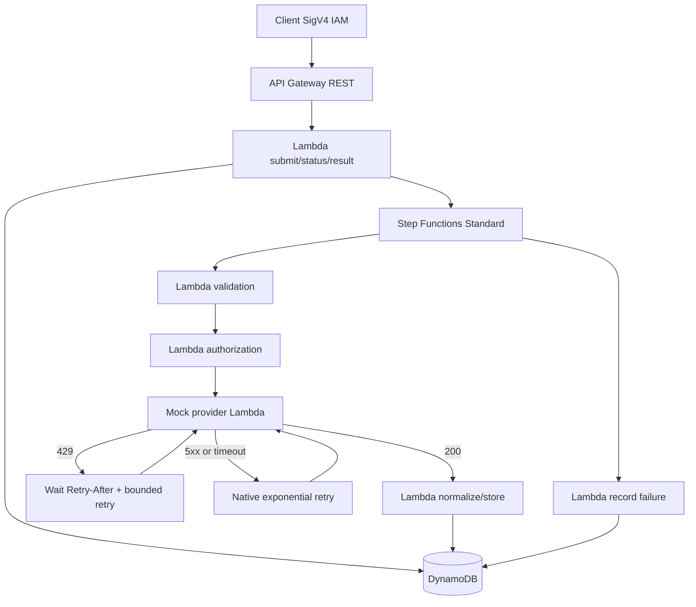

# Architecture EDR — choix de conception

- API Gateway REST + IAM/SigV4: no embedded API keys; every caller must be granted `execute-api:Invoke` separately. This Terraform project intentionally does not create client credentials.
- Status/result access is scoped to the IAM caller ARN (`requestContext.identity.userArn`) stored as owner. For assumed roles, production identity design should explicitly address role session identity stability.
- Step Functions Standard is selected for long-lived asynchronous orchestration and status tracking.
- DynamoDB PAY_PER_REQUEST stores a simple item per request; encryption at rest and PITR are enabled.
- Mock Lambda avoids external dependencies. Secrets Manager secret metadata exists, no secret value is provisioned. In a real provider integration, grant `secretsmanager:GetSecretValue` only to the consuming Lambda and use the secret without logging it.
- AWS service logs are retained for 14 days; Step Functions execution input logging disabled to reduce data leakage.
- API-level throttling is configurable; provider 429 uses a dynamic Wait and a maximum of 3 retries; 5xx and timeouts use Step Functions Retry exponential backoff with 3 attempts.
- No VPC is needed for public regional API Gateway/Lambda and managed services in this mock. For a private provider, add VPC endpoints/NAT appropriately.
- Remaining production work: WAF, end-to-end tracing, DLQ/recovery, quota and spend alarms, user entitlements, payload size limits, retention/TTL policies, contract tests, deployment pipeline.
